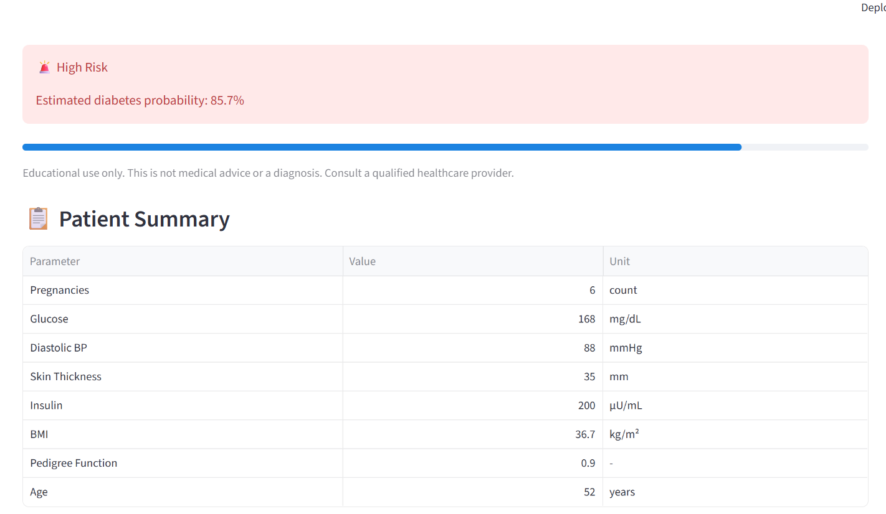
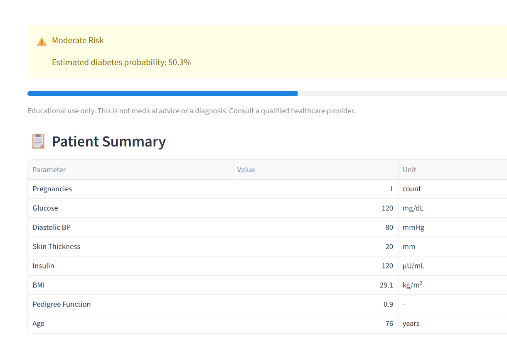
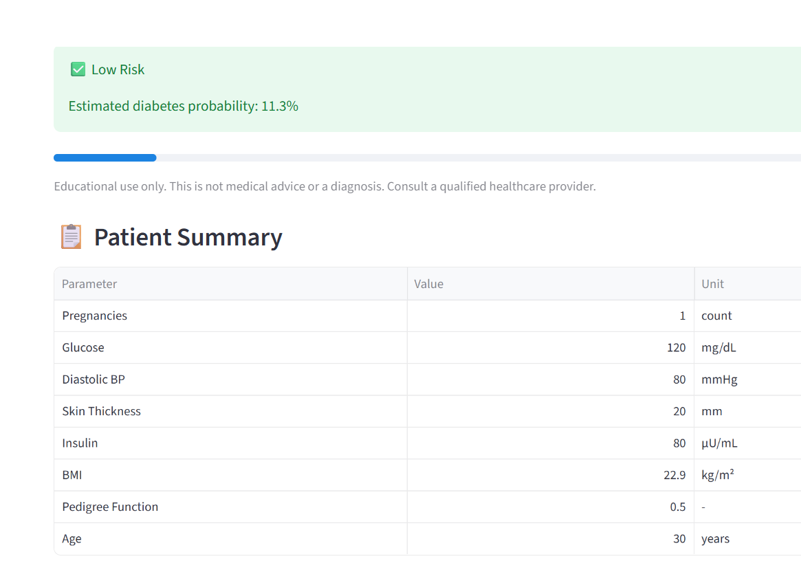

# 🩺 Diabetes Prediction System   **[Live Demo](https://hooman-diabetes-prediction-system.streamlit.app/)**


A machine learning web app that estimates diabetes risk from patient health metrics. Built with **Streamlit** and a **Random Forest** pipeline trained on the Pima Indians Diabetes dataset (768 patients).

## Performance

Evaluated with stratified 5-fold cross-validation on all 768 patients:

| Metric | Score |
|---|---|
| Accuracy | 76.9% |
| Recall (diabetic class) | 67.9% |
| Precision | 66.7% |
| F1 | 67.3% |

On a stratified 80/20 hold-out split: 74.7% accuracy, 66.7% recall.

Recall is the headline metric because this is a screening-style problem, where missing a diabetic patient costs more than a false alarm. `class_weight="balanced"` raised cross-validated recall from about 59% to about 68% with no loss in accuracy.



## Features

- Interactive UI with a real-time BMI calculator
- Estimated diabetes probability with Low / Moderate / High risk bands (under 35%, 35–60%, over 60%)
- Probability chart (diabetic vs non-diabetic)
- Rule-based risk factor flags (glucose, BMI, blood pressure, age, family history)
- Patient summary table
- Unknown lab values can be entered as `0`; the model substitutes the training-set median

## Project Structure

```
├── Diabetes-prediction.py   # Streamlit web app
├── train_model.py           # Training + evaluation script
├── trained_model.sav        # Trained pipeline (pickle)
├── diabetes.csv             # Pima Indians Diabetes dataset (768 rows)
└── requirements.txt
```

## Run Locally

```bash
pip install -r requirements.txt
streamlit run Diabetes-prediction.py
```

Open http://localhost:8501.

## Retrain the Model

```bash
python train_model.py
```

This prints hold-out and cross-validated metrics and overwrites `trained_model.sav`. The pickled model must be loaded with the same scikit-learn version it was trained with (see `requirements.txt`).

## Modeling Notes

- **Data cleaning:** in this dataset, `0` in Glucose, BloodPressure, SkinThickness, Insulin and BMI means "not recorded" (for example, 374 of 768 Insulin values). These are replaced with the column median inside the model pipeline, so the same handling applies at prediction time.
- **Class imbalance:** about 35% of patients are diabetic, so the forest uses balanced class weights.
- **Model:** `RandomForestClassifier` with 200 trees and `min_samples_leaf=3`.
- **Limitations:** the dataset is small and limited to adult female patients of Pima Indian heritage, so results should not be generalized.

## Input Features

| Feature | Description | Unit |
|---|---|---|
| Pregnancies | Number of pregnancies | count |
| Glucose | Plasma glucose concentration | mg/dL |
| Blood Pressure | Diastolic blood pressure | mmHg |
| Skin Thickness | Triceps skin fold thickness | mm |
| Insulin | 2-hour serum insulin | μU/mL |
| BMI | Body mass index (auto-calculated) | kg/m² |
| Diabetes Pedigree Function | Genetic likelihood score | n/a |
| Age | Patient age | years |

## Disclaimer

For educational and informational purposes only. Not a substitute for professional medical advice, diagnosis, or treatment.

